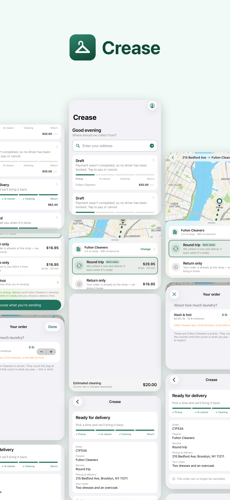
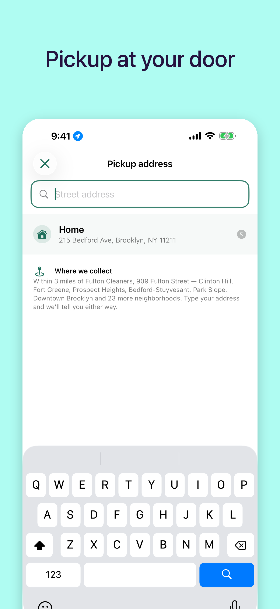
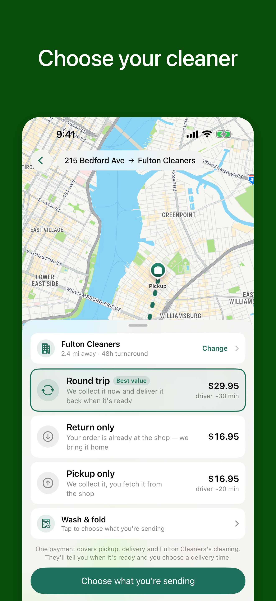
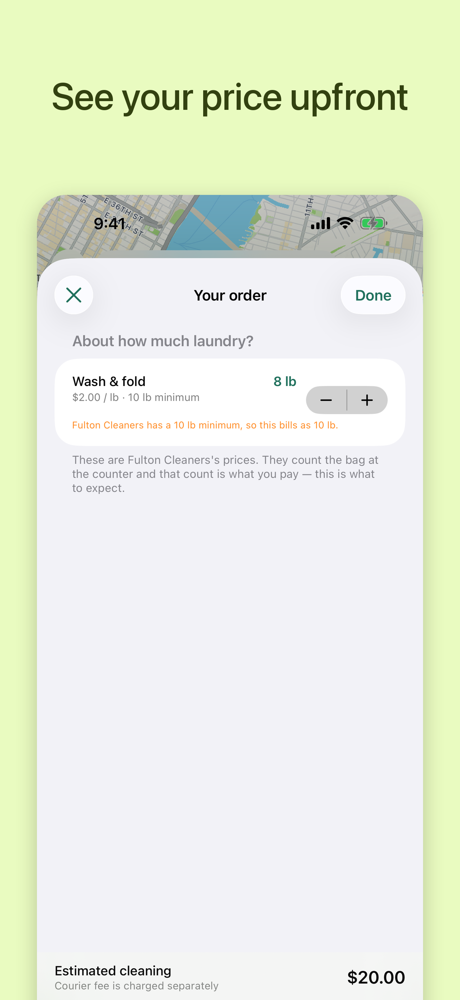
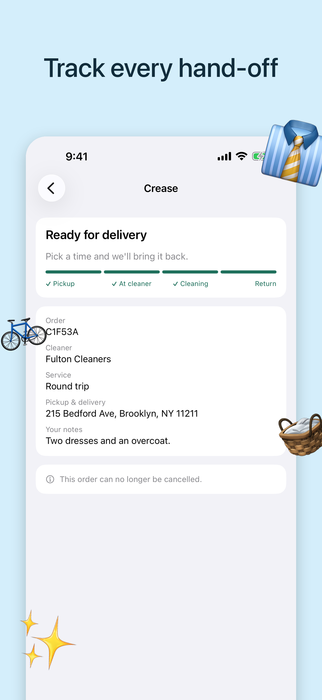

<h1 align="center"> Crease </h1> <br>
<p align="center">
  <a href="https://creasenyc.com/">
    
  </a>
</p>

<p align="center">
  Dry cleaning picked up and delivered in Brooklyn. Built with SwiftUI, Next.js and Fastify.
</p>

<p align="center">
  <a href="https://creasenyc.com/"><b>creasenyc.com</b></a>
</p>

## Table of Contents

- [Introduction](#introduction)
- [Features](#features)
- [Feedback](#feedback)
- [Build Process](#build-process)
- [The Two Constraints That Shape Everything](#the-two-constraints-that-shape-everything)
- [What the Numbers Say](#what-the-numbers-say)
- [Architecture](#architecture)
- [Security Posture](#security-posture)
- [Bugs Worth Knowing About](#bugs-worth-knowing-about)
- [Licence](#licence)

## Introduction

Dry cleaning picked up and delivered, routed through third-party courier
networks. iOS app for customers, web portal for partner cleaners, and a
dispatch service that orchestrates couriers and money.

Built as a working system rather than a demo: it is deployed, the payment paths
are verified against Stripe's live API, and the courier costs quoted below came
back from Uber's production endpoint.

**The iPhone app is in beta on TestFlight. Partner cleaners use a web portal.**

<p align="center">
  
</p>

## Features

A few of the things you can do with Crease:

* Schedule a pickup from your door
* Choose the service you need and see an estimate before you book
* Approve the final price once the cleaner has counted your garments
* Track both courier trips: to the cleaner, and back to you
* Pay with Apple Pay or a card; the hold is only captured for what was cleaned
* For partner cleaners: take in orders, price them and dispatch couriers from a web portal

<p align="center">
  
  
  
  
</p>

## Feedback

Feel free to [file an issue](https://github.com/divinedavis/Crease/issues/new). Feature requests are always welcome.

## Build Process

```bash
npm install
cp .env.example services/dispatch/.env      # fill in Supabase + a secret
npm run build --workspaces
node services/dispatch/dist/index.js
```

With no carrier or Stripe credentials, the simulator and mock payment provider
take over and the entire two-leg flow runs end to end.

```bash
export CREASE_TEST_PASSWORD=…    # not committed; seeds and tests read it
node scripts/seed.mjs            # one cleaner, one customer, one order
node scripts/e2e.mjs             # full two-leg cycle, asserted at every hop
node scripts/e2e-money.mjs       # under / over the hold, and cancellation
node scripts/e2e-payouts.mjs     # onboarding, sweep, double-pay protection
node scripts/rls-check.mjs       # tenant isolation
./scripts/ios-test.sh            # iOS UI + unit tests
```

Against real providers:

```bash
node scripts/stripe-check.mjs    # needs STRIPE_SECRET_KEY (sk_test_)
node scripts/uber-check.mjs      # quotes only; --create dispatches a real courier
```

## The Two Constraints That Shape Everything

Most of the interesting design here follows from two facts about dry cleaning
that do not apply to food delivery.

**1. It is two deliveries, not one.** A cleaner needs the garments for two
days, and no courier network will hold a package that long. So every order is
two independent courier trips — customer → cleaner, then cleaner → customer —
with a multi-day gap in the middle. `delivery_legs` is the boundary where that
lives, and the same leg status means different things depending on which trip
it belongs to.

**2. The price is unknown at checkout.** Nobody can cost a bag before opening
it. The customer picks an estimate; the shop counts the actual garments hours
later. That makes authorize-then-capture the only honest money model — and it
makes one case load-bearing: what happens when the count comes in *above* what
was authorized.

Card networks refuse a capture above the hold. A naive implementation does not
throw there, it clamps — and quietly undercharges every order where a customer
underestimated their own laundry. So an over-count raises a typed
`OverAuthorizationError`, nothing is captured, the order moves to
`awaiting_approval`, and only once the customer agrees is the hold captured and
the remainder charged separately.

## What the Numbers Say

Courier quotes are fetched live, so the economics are measured rather than
assumed ([`scripts/pricing-model.mjs`](scripts/pricing-model.mjs)):

```
one leg  $12.99      two legs  $25.98      (Brooklyn, flat under ~3 miles)
```

Against a median basket where the shop charges $33.43, the couriers cost 78% of
the cleaning itself. Every order at that size loses roughly $21 unless the
customer is charged about double the shop price. Three things move it, and only
three: halve the legs, raise the minimum basket, or own the driver. Commission
rate barely matters — 20% → 40% recovers $6.68 and still loses money.

That result is why the repo has a pricing model in it at all. It was cheaper to
learn from an API call than from a hundred orders.

## Architecture

```
apps/ios          SwiftUI customer app — book, track both legs, approve repricing
apps/portal       Next.js portal for partner cleaners — intake, pricing, dispatch
services/dispatch Fastify — order state machine, courier webhooks, money
packages/delivery Carrier abstraction: Uber Direct + a simulator
packages/payments Stripe + Connect, and a mock enforcing the same rules
supabase          Schema and RLS policies
growth/prospects  Founder-only: the street canvass tool and the expansion roadmap
```

**The expansion plan is a page, not a document.** Five markets in order —
Brooklyn by the end of 2026, Manhattan by mid-2027, then Queens, Staten Island
and New Jersey at six-month steps — and every number on it is read live from
the canvass list and the active partner shops rather than typed in. A market is
finished when four observable gates are met (list seeded, list fully canvassed,
a shop said yes, a partner is live), so the roadmap can say a phase is behind
schedule on evidence instead of on a feeling. Both pages sit behind HTTP basic
auth at `portal.usecreaseapp.com/prospects/`, and RLS narrows the canvass data
to one account on top of that.

**Carriers are behind an interface with an ordered fallback chain.** Coverage
holes at the edge of a service radius are routine, so falling through to a
second carrier is load-bearing rather than decorative. `MockProvider` walks a
delivery through the real status sequence on a timer and posts *signed*
webhooks back at the service's own endpoint — so the signature check, dedupe
and state machine are exercised for real without any carrier credentials.

**Uber Direct dispatches Uber Eats couriers, not the rideshare fleet.** Uber's
public Ride Request API was withdrawn from third parties years ago; "hire an
Uber driver to run an errand" is not a thing that can be built.

## Security Posture

- The portal runs on the Supabase anon key and never the service role, so
  **RLS** — not query hygiene — is what keeps one shop out of another's orders.
  [`scripts/rls-check.mjs`](scripts/rls-check.mjs) signs in with the anon key
  like a real browser and asserts a rival shop's order is invisible to list,
  invisible to fetch-by-id, and immune to update.
- Carrier webhooks are HMAC-verified over the **raw bytes**, before any
  `JSON.parse` — re-serializing changes key order and breaks the signature.
  Every payload lands verbatim in `delivery_events` before it is applied, valid
  or not, so a mis-parse can be replayed instead of lost.
- The internal dispatch API is loopback-only at the nginx layer; only the
  webhook endpoint is public, because carriers will not call a private host.
- No card data touches the database — only opaque provider handles.

## Bugs Worth Knowing About

Kept here because each was invisible until something ran for real, and each is
the kind that produces a wrong answer rather than an error.

- **Refunds recorded as zero.** Stripe's current API version removed `charges`
  from the PaymentIntent in favour of `latest_charge`. Reading the old shape
  does not fail — it yields `0`, so a refunded payment kept reporting itself as
  fully captured while the money had already left.
- **A duplicate dispatch sent a second courier.** The "already live" guard
  stopped matching once a leg reached `delivered`, so re-dispatching a
  completed pickup routed a courier to the customer's door for a bag already at
  the cleaner. Now refused, with a partial unique index enforcing it in Postgres.
- **An unfunded order could get a courier.** A customer with no saved card
  produces an intent that is created but unconfirmed — no funds held. Nothing
  on the dispatch path checked, so a courier would have been paid to collect
  against nothing.
- **`atCleaner` lit the "Cleaning" step.** A bag that had just been dropped off
  rendered a progress track identical to one genuinely in progress. It looks
  entirely plausible on screen, which is why it needed an assertion and not an
  eyeball.
- **A test harness that could not fail.** An assertion helper defined as
  `(label, ok, detail)` but called as `(label, actual, expected)` — every
  non-empty string counted as a pass. Worse than no assertion, because it reads
  as evidence.

## Licence

MIT — see [LICENSE](LICENSE).
